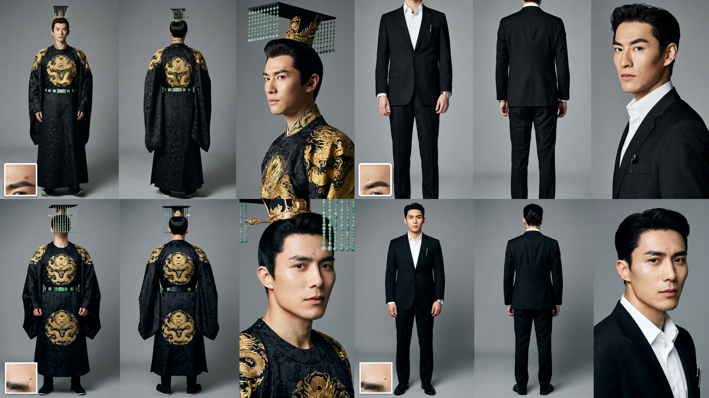
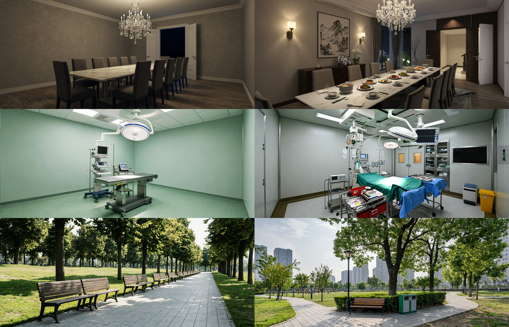

# film-asset-pipeline

**一个剧本进去，一份资产网页出来**：这部戏要哪些场景、角色（几套衣服、什么状态）、道具、特效，每一份怎么设计，
用什么提示词出图，出好的图贴在旁边。三个 Claude Code skill 按顺序配合，靠资产标签（`@loc_xxx`、`@char_xxx`）串起来。

出图模型用的是 MiniMax 开源的 **H3-Image**。没有跑图机也能用：网页上复制提示词、在自己的工具里出图、把图拖回网页。

> 这个仓库是《MiniMax H3-Image 能否替代影视出图？》这期视频的实测产物。下面「这个项目里做过的尝试」记下了一路上踩过的坑和每一步的对比图。

---

## 三个 skill，一条线

| 顺序 | skill | 管什么 | 交出什么 |
|---|---|---|---|
| 1 | [`ad-asset-bible`](ad-asset-bible/)（副导演） | 剧本里有几个场景、角色几套衣服几种状态、跨场景的道具、会重复出现的特效，每场戏用哪一份；另写每个角色怎么演、什么声音（角色档案，给后面写视频提示词用） | 盘点 JSON |
| 2 | [`art-designer`](art-designer/)（美术设计） | 把"戏需要什么"设计成一个可信、完整、有生活痕迹的地方、造型、道具、特效 | 设计稿 JSON |
| 3 | [`h3-image-film-assets`](h3-image-film-assets/)（出图） | 把设计写成 H3-Image 的提示词，定尺寸和参考图；有出图通道就出图 | 出图单 JSON，和图 |

[`PIPELINE.md`](PIPELINE.md) 是写给执行 agent 的调度文档：先问哪些问题、每一步交接什么、文件怎么摆、出了问题改哪一层。

最后的网页顶上三个大 Tab，三个 skill 的产出各占一页，同一张图三页都显示，要哪一步就去哪一页复制：

- **需求清单**（副导演）：场景 / 角色·服装 / 关键道具 / 特效 / 角色档案五张表
- **美术设计**（设计师）：按同样的分类，一张卡一条设计，带图
- **提示词**（出图）：按参考图依赖排好顺序的出图单。复制提示词，出好的图拖到卡上，点「保存网页」下载一份带图的新网页

<!-- 截图：网页三个阶段 Tab -->

## 快速开始

**需要**：Node.js 18+、ffmpeg（缩图用）。出图可选：一台装了 H3-Image 的 ComfyUI，或 MiniMax API key。

```bash
git clone https://github.com/EVZheng-Lab/film-asset-pipeline.git
```

在 Claude Code（或别的能读文件、跑命令的 agent）里说：

> 读 `film-asset-pipeline/PIPELINE.md`，帮我把这个剧本的资产做出来。剧本在 `<路径>`，剧名《…》。我（有 / 没有）出图通道。

agent 会依次读三个 skill 的 `SKILL.md` 照着做，中间不停下来等你审文字 —— 拿不准的地方它照最合理的猜，猜了什么写进汇报，
你看图时觉得不对再回头改。产出放在一个工作目录里：

```
<剧名>/
  资产盘点-<剧名>.html   打开这个就行
  汇报.md               盘了什么、哪些是猜的、出图单怎么用
  数据/                 盘点 / 设计稿 / 出图单 JSON，回头修改从这里改
  图/                   出好的图（有出图通道时）
```

### 出图的三种情况

| 你有什么 | 怎么出 |
|---|---|
| 一台装了 H3-Image 的 ComfyUI | `node h3-image-film-assets/scripts/render-comfyui.mjs 数据/出图单.json 图/ --server http://<主机>:8188`，按依赖顺序出，断了重跑接着出 |
| MiniMax API key | `h3-image-film-assets/scripts/generate.py`（官方脚本） |
| 都没有 | 打开网页「提示词」页，复制提示词去自己的工具里出，图拖回卡上，保存网页 |

ComfyUI 存的 PNG 里带着提示词，所以出完图可以整个文件夹交给 `ad-asset-bible/scripts/attach-images.mjs`，它按图里的提示词自动配回对应的资产，不看文件名。

---

## 这个项目里做过的尝试

测试剧本是一部 12 集的都市修仙短剧（现代都市 + 古代闪回），跑图机是一张 RTX 4080，H3-Image 官方 ComfyUI 工作流
（蒸馏版，参数锁死 6 步 / CFG 1 / euler / simple，没有可调的）。下面每一条都是一个真实踩到的问题和它最后的解法，按时间顺序。

### 1. 同一个角色，每张图都不像同一个人 → 先出一张脸图，所有服装都拿它当参考

最早每套服装各自文生图，同一段长相描述、同一个种子，出来的脸明显不是同一个人。
改成：先出一张**脸图**（灰底头肩照、素色 T 恤），之后这个角色的每一套服装、每一个状态，都拿这张脸图当参考图出。


*上：两套服装各自文生图。下：先出脸图，两套都拿它当参考。*

也试过拿一整张服装三视图当参考去换衣服，不行：版面和服装会跟要改的内容打架（中间那格背面变成正面、特写没换衣服）。
所以参考图只给脸。

### 2. 编辑一次就有噪点，编辑两次就不能用了 → 只编辑一次，参考图和输出都用 4MP

H3-Image 的编辑（带参考图出图）有两个坑：

- **用 16MP 编辑**：整张图噪点重、像过拟合，要改的地方也改不上去。对照官方编辑工作流才发现，它先把参考图缩到约 4MP，输出也是 4MP。
  按 4MP 编辑就干净了。代价是编辑出来的图只有 4MP（文生图是 16MP）。
- **连续编辑**：拿编辑出来的图再去编辑，噪点一轮轮累积。下图是同一张文生图连续编辑 4 次（每次只改一小处）的局部，
  第 1 次还能用，第 2 次噪点已经很大，第 3 次就不能用了（灰底先出斑驳，再出彩色噪块）：


*从左到右：文生图原图、编辑第 1 / 2 / 3 / 4 次（同一位置的局部）。*

结论：**参考图永远是一张干净的文生图，每张图只从它编辑一次**；要改好几处，合成一条提示词一次改完。
状态变体（受伤、施法）也不拿服装成图再改，而是拿脸图当参考，把"这套衣服 + 这个状态"完整写一遍：


*左：从服装成图再编辑出的状态变体（编辑了两次）。右：从脸图一次编辑出来。灰底的斑驳、脸上的颗粒差别很明显。*

### 3. 状态只写了衣服，脸和手还是干净的 → 状态变体写到全身

"战后"只写"龙袍沾满尘土"，出来衣服脏了，脸、头发、冠冕、手还是干净的 —— 写什么改什么。
现在规则是状态要落到每个看得见的部位：脸（尘土、汗痕、伤口）、头发（散下几缕）、手（指节擦破）、鞋、头饰、衣服，而且要有来由。
上一张图的龙袍就是这么写的。

### 4. 场景又空又假 → 先做美术设计，再写提示词

直接把副导演的需求翻成提示词，餐厅只有一张桌子几把椅子、墙上什么都没有；手术室一张床一台机器；公园的长椅排成列队。
写提示词的 agent 其实知道手术室里该有什么，只是没人要求它去设计。H3 这类模型写什么画什么，不会自己补细节。
于是加了**设计师**这一步：以这场戏要用的东西为中心往外设计，按用途把该有的设施写全，交代谁在用、维护得怎样、此刻什么状态。


*左：需求直接写成提示词。右：先设计再出图。从上到下：餐厅、手术室、公园。*

### 5. 为了"真实"写破损，出来是刻意的破败 → 痕迹跟着维护水平走

加了设计之后又矫枉过正：手术室写了"地上散着包装和带血纱布"，像事故现场，不像有管理的医院；
公园写了"几块砖碎了"，出来是长椅正前方一大块刻意的破损。改成：痕迹的多少跟着**这个地方有没有人维护、管得多严**走，
只写整体的使用程度，破损只有剧情需要时才写。


*左：点名写破损和脏乱。右：按维护水平重写。上：手术室抢救后；下：公园。*

### 6. 写死数量和位置，模型就把它当主角去堆 → 给规则，不给画面

公园写了"四张长椅、两张挨着、一张在拐弯处、有新有旧"，出来五张一模一样的长椅排成一列。
写得越细，模型越把它当主角。改成：只说**有什么**和**按什么规则摆**（随意、有疏有密、不排成列），
具体怎么摆交给模型；只有戏要用的那件东西和参照物写具体。


*上：写死数量和位置。中：只给有什么和规则。下：再以戏要用的那张长椅为中心往外设计。*

### 7. 流程上的几个定案

这些没有对比图，但都是试跑里反复卡住、最后定下来的规则：

- **衍生场景**：只有在同一个全景镜头里看得见的区域（开放式的客厅、餐厅、厨房）才拿全景图当参考出；
  它的变体也拿那张全景图，不拿编辑出来的图。看不见的区域（医院的手术室、走廊、病房）各自文生图，风格一致靠设计师写的共用约定。
- **画面里有某个人的形象**（墙上挂的照片、神庙的雕像）：先文生图出一张空着的底图（空相框），带形象的版本拿底图 + 脸图编辑一次，
  反打也从底图出 —— 房间布置一致，每张都只编辑一次。
- **同一张脸、不是同一个人**（穿越前后的原主、闪回里的前世）：当成两个演员，两份档案，共用一张脸图。
- **没有人物、没有戏的空镜**（一轮圆月）不建场景资产，交给视频提示词。
- **身上的光**：出现在两场以上才算服装的状态变体；只出现在一场的交给视频提示词。独立释放出去的（光索、传送光环）才是特效，特效图只画光本身。
- **辨识点**（纹身、疤、痣）剧本写了才有，不为了防止长相跑偏去编。

### 8. 用全新的 agent 盲测文档，前后跑了四遍

规则写进文档之后，每次都派一个**没有任何上下文**的 agent，只给它剧本和这个仓库，从头跑一遍，记下文档哪里卡住了它，再改文档：

| 次 | 改了什么之后 | 卡点 |
|---|---|---|
| 1 | 三个 skill 刚接成一条线 | 18 处：两份文档对脸图说法相反、设计师拿不到"戏的中心"、辨识点被逼着编…… |
| 2 | 设计师补上角色、道具、特效 | 19 处：衍生场景和"只编辑一次"冲突、全剧约定没地方放…… |
| 3 | 文档精简：约 26.6 万字节 → 9.2 万字节 | 20 处，都是更细的边界情况；三步脚本零报错 |
| 4 | 补完第 3 次的边界规则，第一次真的出图 | 见下一节 |

<!-- 第 4 次的结果和新旧对比图在出完图后补上 -->

---

## 已知的局限

- **编辑只能一次、只有 4MP**：H3-Image 蒸馏版没有可调的参数，连续编辑必然累积噪点。需要更高分辨率的编辑图只能靠后期放大。
- **一致性是概率性的**：三视图中间那格偶尔出成正面、鞋子款式偶尔变，换个种子重出就好。
- **画面里的字**：中文招牌容易乱码。规则是除了剧本写明必须有的字，一律声明不要字。
- **盘点是猜的**：衣服剧本没写、场次地点写错、同一场日夜矛盾，agent 都会照最合理的猜，猜了什么写进汇报。漏的、错的，做分镜时会暴露，回头改盘点。

## 文件和许可

- `h3-image-film-assets` 改自 [MiniMax-AI/MiniMax-H3-Image](https://github.com/MiniMax-AI/MiniMax-H3-Image) 官方的 `h3-image-prompt-writing` skill（Apache-2.0），
  改动范围见它的 `SKILL.md` 顶部声明和 `NOTICE`；新增的是 `references/film-assets.md` 和 `scripts/render-comfyui.mjs`。
- `ad-asset-bible` 另有一个[独立发布的版本](https://github.com/EVZheng-Lab/ad-asset-bible)，下游接的是 Higgsfield 的 Lira。
  本仓库里的这份是为这条流水线改过的：不停下等审阅、没有原型清单（交给设计师）、多了几个跟出图配合的字段。
- 许可：<!-- 待定 -->
