# film-asset-pipeline

**一个剧本进去，一份资产网页出来**：这部戏要哪些场景、角色（几套衣服、什么状态）、道具、特效，每一份怎么设计，
用什么提示词出图，出好的图贴在旁边。两个 Claude Code skill 按顺序配合，靠资产标签（`@loc_xxx`、`@char_xxx`）串起来。

出图模型用的是 MiniMax 开源的 **H3-Image**。没有跑图机也能用：网页上复制提示词、在自己的工具里出图、把图拖回网页。

> 这个仓库是《MiniMax H3-Image 能否替代影视出图？》这期视频的实测产物。下面「这个项目里做过的尝试」记下了一路上踩过的坑和每一步的对比图。

---

## 整条流程

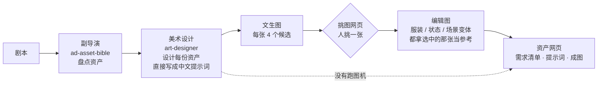

1. **副导演**读剧本，盘出这部戏要哪些场景、角色（几套衣服、什么状态）、道具、特效，每场戏用哪一份。
2. **设计师**把每份资产设计具体：这个地方按用途该有什么、这个人此刻穿成什么样、这件道具用了多久；
   想完直接写成 H3-Image 的中文提示词，按资产图的固定格式定尺寸和参考图。
3. 有跑图机：先只出**文生图**（每个角色的第一套服装、主场景、道具、特效），每张 4 个候选，人在挑图网页里选；
   都不满意的点「都不要，重抽」并写上原因，先改设计或写法再重抽。选完再出所有拿它们当参考的**编辑图**。
   没有跑图机：直接到网页上复制提示词，自己出图，拖回网页。
4. 最后交一份**资产网页**：副导演的需求清单、每份资产的提示词和成图，都在一个页面里。

## 两个 skill，一条线

| 顺序 | skill | 管什么 | 交出什么 |
|---|---|---|---|
| 1 | [`ad-asset-bible`](ad-asset-bible/)（副导演） | 剧本里有几个场景、角色几套衣服几种状态、跨场景的道具、会重复出现的特效，每场戏用哪一份；另写每个角色怎么演、什么声音（角色档案，给后面写视频提示词用） | 盘点 JSON |
| 2 | [`art-designer`](art-designer/)（美术设计） | 把"戏需要什么"设计成一个可信、完整、有生活痕迹的地方、造型、道具、特效，直接写成 H3-Image 的中文提示词，定尺寸和参考图；有 ComfyUI 就出图 | 出图单 JSON，和图 |

[`PIPELINE.md`](PIPELINE.md) 是写给执行 agent 的调度文档：先问哪些问题、每一步交接什么、文件怎么摆、出了问题改哪一层。

最后的网页顶上两个大 Tab，两个 skill 的产出各占一页，同一张图两页都显示：

- **需求清单**（副导演）：场景 / 角色·服装 / 关键道具 / 特效 / 角色档案五张表
- **提示词**（设计师）：顶上是整部戏共用的设计约定，下面是按参考图依赖排好顺序的出图单。复制提示词，出好的图拖到卡上，点「保存网页」下载一份带图的新网页

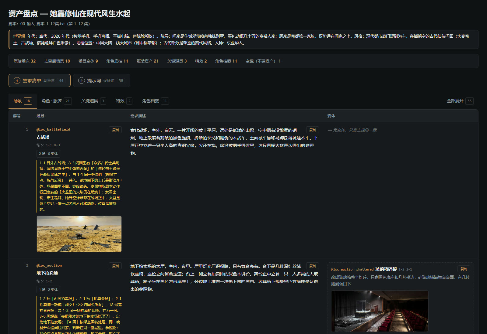
*需求清单：副导演的盘点，每份资产带成图。*

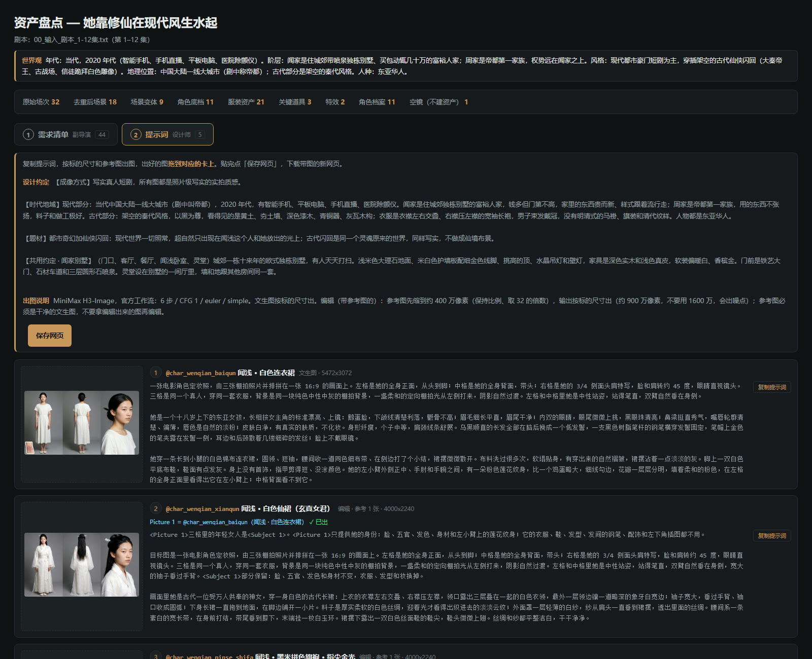
*提示词：顶上是设计约定，下面是按参考图依赖排好的出图单，每张卡标出参考图出没出；没有出图通道时，出好的图拖到卡上。*

## 快速开始

**需要**：Node.js 18+。出图可选：一张 NVIDIA 显卡（16GB 显存实测能跑，12GB 大概率能跑，内存 64GB 比较稳），或者云端 / 局域网里一台装了 H3-Image 的 ComfyUI。
ComfyUI、模型、ffmpeg 没装也没关系：agent 开始前会先查你的电脑，配置够就问你一次装在哪，然后全走国内源装好（约 51GB）；配置不够就只出提示词。

```bash
git clone https://github.com/EVZheng-Lab/film-asset-pipeline.git
```

在 Claude Code（或别的能读文件、跑命令的 agent）里说：

> 读 `film-asset-pipeline/PIPELINE.md`，帮我把这个剧本的资产做出来。剧本在 `<路径>`，剧名《…》。用这台电脑出图（或：用 `http://<主机>:8188` 那台出图）。

agent 会依次读两个 skill 的 `SKILL.md` 照着做，中间不停下来等你审文字 —— 拿不准的地方它照最合理的猜，猜了什么写进汇报，
你看图时觉得不对再回头改。产出放在一个工作目录里：

```
<剧名>/
  资产盘点-<剧名>.html   打开这个就行
  汇报.md               盘了什么、哪些是猜的、出图单怎么用
  数据/                 盘点 / 出图单 JSON，回头修改从这里改
  图/                   出好的图（有出图通道时）
```

### 出图的两种情况

| 你有什么 | 怎么出 |
|---|---|
| 一台能跑 H3-Image 的电脑（agent 帮你装好），或装好了的 ComfyUI | `render-comfyui.mjs` 分两段：先只出文生图（每个角色的第一套服装、主场景、道具、特效），每张 4 个候选，双击打开挑图网页点选（可以只看待选的），4 张都不满意就打回并写原因，点「复制选择」回对话粘贴；选完再出所有拿它们当参考的编辑图。不会在你不满意的底图上白出一堆 |
| 没有 | 打开网页「提示词」页，复制提示词去自己的工具里出，图拖回卡上，保存网页 |

```bash
S=art-designer/scripts/render-comfyui.mjs
node $S 数据/出图单.json 图/ --server http://<主机>:8188 --stage t2i      # ① 文生图，每张 4 个候选 → 图/候选/挑图.html
node $S 数据/出图单.json 图/ --pick "<挑图网页「复制选择」复制的文字>"    # ② 双击打开 图/候选/挑图.html 选，复制粘贴回来
node $S 数据/出图单.json 图/ --server http://<主机>:8188 --stage edit     # ③ 编辑图，参考选中的那张
```

用到的 ComfyUI 工作流和模型下载地址在 [`art-designer/comfyui/`](art-designer/comfyui/)：
出图脚本跑的就是里面那两个工作流文件，官方模板也原样带着，并写明了我们改了哪两处。

ComfyUI 存的 PNG 里带着提示词，所以出完图可以整个文件夹交给 `ad-asset-bible/scripts/attach-images.mjs`，它按图里的提示词自动配回对应的资产，不看文件名。

---

## 这个项目里做过的尝试

测试剧本是一部 12 集的都市修仙短剧（现代都市 + 古代闪回），跑图机是一张 RTX 4080，H3-Image 官方 ComfyUI 工作流
（蒸馏版，参数锁死 6 步 / CFG 1 / euler / simple，没有可调的）。下面每一条都是一个真实踩到的问题和它最后的解法，按时间顺序。

### 1. 同一个角色，每张图都不像同一个人 → 拿一张图当身份参考（先是脸图，后来改成第一套服装）

最早每套服装各自文生图，同一段长相描述、同一个种子，出来的脸明显不是同一个人。
改成：先出一张**脸图**（灰底头肩照、素色 T 恤），之后这个角色的每一套服装、每一个状态，都拿这张脸图当参考图出。


*上：两套服装各自文生图。下：先出脸图，两套都拿它当参考。*

当时也试过拿一整张服装三视图当参考去换衣服，版面和服装跟要改的内容打架（中间那格背面变成正面、特写没换衣服），所以参考图只给脸。

**后来又改了回来：第一套服装的三视图就是身份图。** 脸图有个解决不了的问题 —— 辨识点不在脸上时（手臂纹身），头肩照里放不下：
把手臂抬进画面，结构跟肖像对不上，像另外贴上去的；单独画一条手臂的贴纸，又看不出在小臂还是大臂，手心手背还可能画反。
回头重测"拿三视图当参考换衣服"才发现，当初失败是因为那次是按 16MP 编辑的（见下一条），按 9MP 重测，版面没乱、衣服换干净、是同一个人。
现在的做法：每个角色把**能露出辨识点的那套衣服**排第一，文生图出三视图，纹身在全身照里看得出在哪、左下角贴纸放大细节；
其余服装和状态变体都拿它当参考编辑一次。底档不再单独出图。

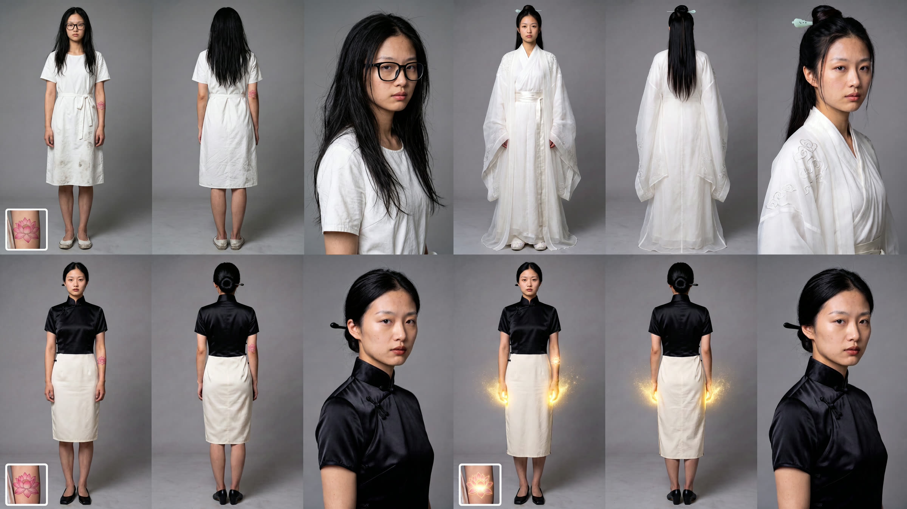
*第五遍全流程里的闻浅。左上：第一套（白裙，文生图），短袖露出小臂纹身。其余三张都拿它编辑一次：右上仙裙（长袖盖住纹身，不加插图）、左下拼色旗袍、右下拼色旗袍 + 施法金光。*

### 2. 编辑一次就有噪点，编辑两次就不能用了 → 只编辑一次，参考图缩到 4MP，输出 9MP

H3-Image 的编辑（带参考图出图）有两个坑：

- **用 16MP 编辑**：整张图噪点重、像过拟合，要改的地方也改不上去。官方编辑工作流把参考图先放大或缩到约 4MP（说明里写的是
  "低分辨率效果不好，所以先放大到 4MP"，4MP 是下限不是上限），输出尺寸跟着参考图走，所以默认是 4MP 出。
  一开始照着改成 4MP 进、4MP 出，干净了，但三视图全身照里的脸只有几十个像素，五官糊成豆腐块。
  后来同一张图试了 4 / 6 / 9 / 16MP 四种输出：**9MP 以下都干净，9MP 的脸清楚多了，16MP 坏掉**（背景斑驳、衣服没换干净）。
  现在定为参考图缩到 4MP、输出约 9MP：

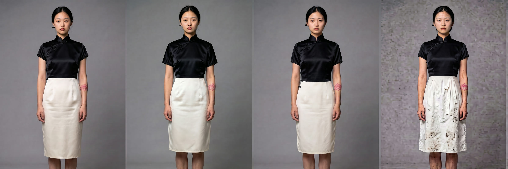
*同一参考图、同一提示词，左边全身照，从左到右输出 4MP / 6MP / 9MP / 16MP。16MP 的裙子还是参考图里那条脏白裙。*

- **连续编辑**：拿编辑出来的图再去编辑，噪点一轮轮累积。下图是同一张文生图连续编辑 4 次（每次只改一小处）的局部，
  第 1 次还能用，第 2 次噪点已经很大，第 3 次就不能用了（灰底先出斑驳，再出彩色噪块）：


*从左到右：文生图原图、编辑第 1 / 2 / 3 / 4 次（同一位置的局部）。*

结论：**参考图永远是一张干净的文生图，每张图只从它编辑一次**；要改好几处，合成一条提示词一次改完。
状态变体（受伤、施法）也不拿那套服装的成图再改，而是拿身份图当参考，把"这套衣服 + 这个状态"完整写一遍：

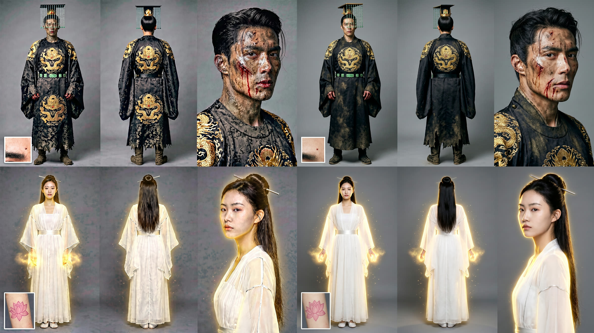
*左：从服装成图再编辑出的状态变体（编辑了两次）。右：从干净的文生图一次编辑出来（当时还是脸图）。灰底的斑驳、脸上的颗粒差别很明显。*

### 3. 状态只写了衣服，脸和手还是干净的 → 状态变体写到全身

"战后"只写"龙袍沾满尘土"，出来衣服脏了，脸、头发、冠冕、手还是干净的 —— 写什么改什么。
现在规则是状态要落到每个看得见的部位：脸（尘土、汗痕、伤口）、头发（散下几缕）、手（指节擦破）、鞋、头饰、衣服，而且要有来由。
上一张图的龙袍就是这么写的。

### 4. 场景又空又假 → 先做美术设计，再写提示词

直接把副导演的需求翻成提示词，餐厅只有一张桌子几把椅子、墙上什么都没有；手术室一张床一台机器；公园的长椅排成列队。
写提示词的 agent 其实知道手术室里该有什么，只是没人要求它去设计。H3 这类模型写什么画什么，不会自己补细节。
于是加了**设计师**这一步：以这场戏要用的东西为中心往外设计，按用途把该有的设施写全，交代谁在用、维护得怎样、此刻什么状态。


*左：需求直接写成提示词。右：先设计再出图。从上到下：餐厅、手术室、公园。*

### 5. 为了"真实"写破损，出来是刻意的破败 → 痕迹跟着维护水平走

加了设计之后又矫枉过正：手术室写了"地上散着包装和带血纱布"，像事故现场，不像有管理的医院；
公园写了"几块砖碎了"，出来是长椅正前方一大块刻意的破损。改成：痕迹的多少跟着**这个地方有没有人维护、管得多严**走，
只写整体的使用程度，破损只有剧情需要时才写。

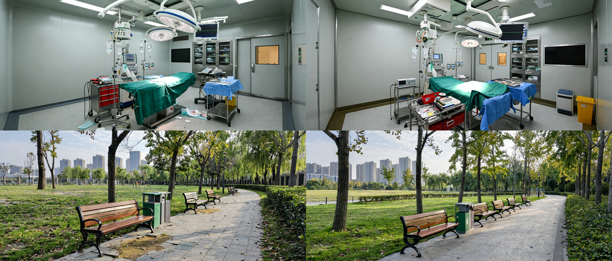
*左：点名写破损和脏乱。右：按维护水平重写。上：手术室抢救后；下：公园。*

### 6. 写死数量和位置，模型就把它当主角去堆 → 给规则，不给画面

公园写了"四张长椅、两张挨着、一张在拐弯处、有新有旧"，出来五张一模一样的长椅排成一列。
写得越细，模型越把它当主角。改成：只说**有什么**和**按什么规则摆**（随意、有疏有密、不排成列），
具体怎么摆交给模型；只有戏要用的那件东西和参照物写具体。

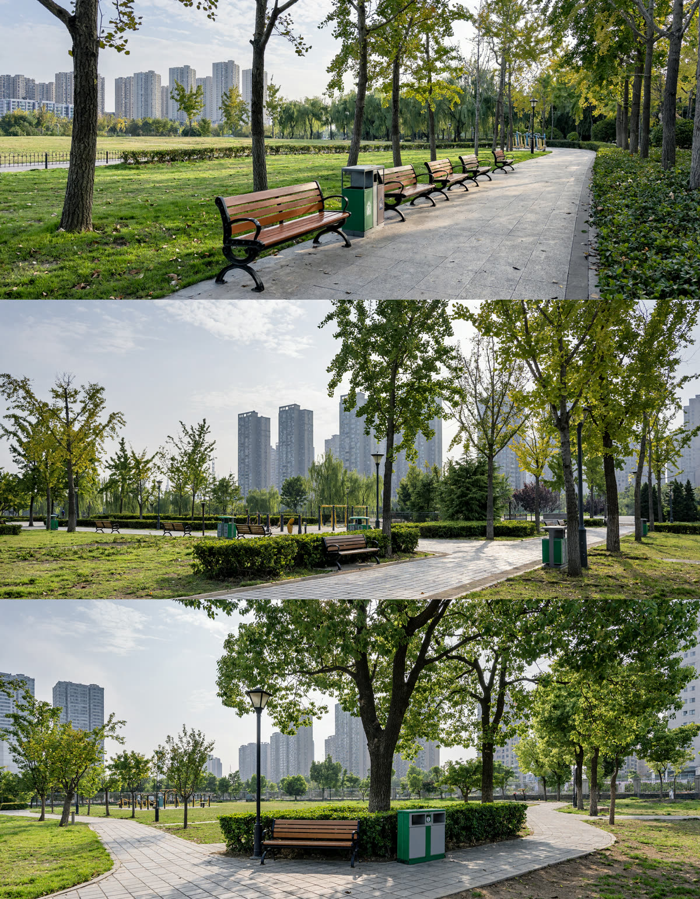
*上：写死数量和位置。中：只给有什么和规则。下：再以戏要用的那张长椅为中心往外设计。*

### 7. 流程上的几个定案

这些没有对比图，但都是试跑里反复卡住、最后定下来的规则：

- **衍生场景**：只有在同一个全景镜头里看得见的区域（开放式的客厅、餐厅、厨房）才拿全景图当参考出；
  它的变体也拿那张全景图，不拿编辑出来的图。看不见的区域（医院的手术室、走廊、病房）各自文生图，风格一致靠设计师写的共用约定。
- **画面里有某个人的形象**（墙上挂的照片、神庙的雕像）：先文生图出一张空着的底图（空相框），带形象的版本拿底图 + 那个人的身份图编辑一次，
  反打也从底图出 —— 房间布置一致，每张都只编辑一次。
- **同一张脸、不是同一个人**（穿越前后的原主、闪回里的前世）：当成两个演员，两份档案，共用一套身份图。
- **没有人物、没有戏的空镜**（一轮圆月）不建场景资产，交给视频提示词。
- **身上的光**：同一套服装在两桩以上的剧情事件里出现才算服装的状态变体（按事件数，不按场次号）；只出现在一桩事件里的交给视频提示词。独立释放出去的（光索、传送光环）才是特效，特效图只画光本身。
- **辨识点**（纹身、疤、痣）剧本写了才有，不为了防止长相跑偏去编。

### 8. 用全新的 agent 盲测文档，前后跑了六遍

规则写进文档之后，每次都派一个**没有任何上下文**的 agent，只给它剧本和这个仓库，从头跑一遍，记下文档哪里卡住了它，再改文档：

| 次 | 改了什么之后 | 卡点 |
|---|---|---|
| 1 | 三个 skill（副导演、设计师、出图）刚接成一条线 | 18 处：两份文档对脸图说法相反、设计师拿不到"戏的中心"、辨识点被逼着编…… |
| 2 | 设计师补上角色、道具、特效 | 19 处：衍生场景和"只编辑一次"冲突、全剧约定没地方放…… |
| 3 | 文档精简：约 26.6 万字节 → 9.2 万字节 | 20 处，都是更细的边界情况；三步脚本零报错 |
| 4 | 补完第 3 次的边界规则，第一次真的出图 | 12 处 |
| 5 | 第一套服装当身份图、编辑输出 9MP、两段出图中间挑图 | 13 处：身上的光按场次还是按事件数、一个灵魂三种身份 `sameFaceAs` 管不到、遗照上的人借了别人的脸怎么写…… 能直接改的 5 处当场改了 |
| 6 | 拔掉官方 skill、设计师直接出中文提示词（只跑设计师这一步，5 张，见第 11 条） | 8 处：背面看不到的辨识点跟"不写否定句"打架、特效没写机位和尺度怎么比、空场景怎么看出"此刻的状态"…… 都补进了文档 |

### 9. 第五遍：从剧本到成图，人只在挑图时插手

第五遍从剧本到出图单都是那个全新的 agent 自己做的，中间没有人看过文字；出图用仓库里的 `render-comfyui.mjs` 分两段跑，
人只在中间挑了一次图：

- 盘出 18 个场景 + 9 个变体、11 个角色 / 21 套服装 / 5 个状态、3 件道具、2 个特效，设计 69 条，提示词 58 条
  （31 张文生图 + 27 张编辑图；不再单独出脸图，比第四遍少 9 张）
- 文生图每张 4 个候选，共 124 张，16MP，约 100 秒一张，一张 RTX 4080 跑了约 3.4 小时
- 挑图：31 个里 28 个直接选定，3 个打回并写了原因（见下一条），改完设计重出 12 张候选再选
- 编辑图 27 张，约 9MP，约 100 秒一张，约 45 分钟；0 失败
- 出完整个文件夹交给 `attach-images.mjs`，按 PNG 里的提示词自动配回，58 张全部配上

跟前面几批同一份资产比（场景是 21:9 全景）：

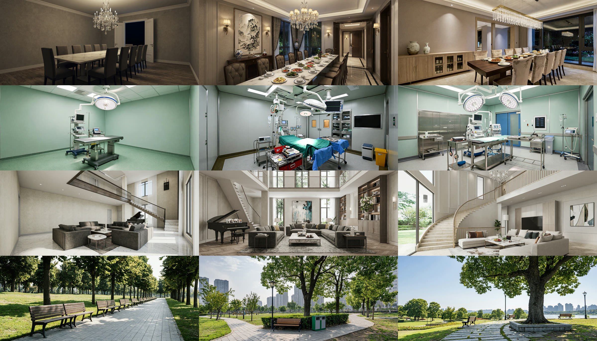
*每行左：最早的做法（需求直接写成提示词）。中：我在对话里边看人工反馈边出的那一批（手术室、公园是逐张改到满意的定稿）。右：第五遍，从 4 个候选里挑的。
从上到下：餐厅、手术室、客厅、公园。*

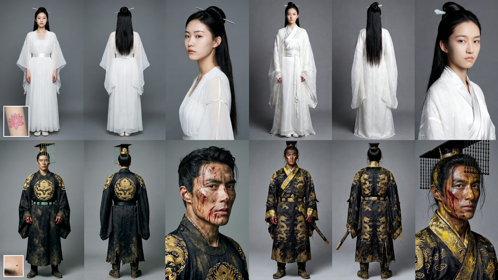
*左：我在对话里边看人工反馈边出的版本。右：第五遍，都从这个角色第一套服装的三视图编辑一次。上：仙裙（长袖盖住了手臂纹身，按规则不加辨识点插图），身份图是白裙那张；下：龙袍战后状态，身份图是西装那张。*

画面里有某人形象的场景，按"空底图 + 编辑一次"出：

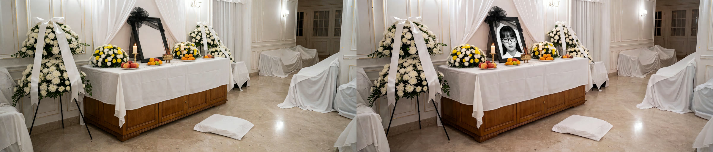
*左：灵堂底图（空相框，文生图）。右：底图 + 身份图编辑一次，放上照片 —— 桌子、花圈、白布盖着的家具都对得上。*

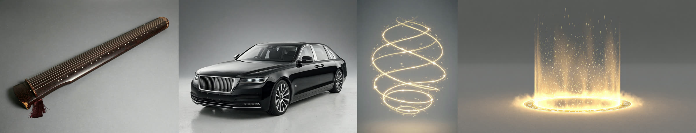
*道具：古琴、车的外观（灰色棚拍地面）。特效：缠绕的光索（只画光，不画人）、瞬移光环。*

**看下来**：比最早的做法好很多；跟边看人工反馈边出的那一批大体同一水平，而这一遍人没看过任何文字，只挑了图。

### 10. 挑图时打回的，光换种子出来还是差不多 → 打回要写原因，先改设计再重抽

第五遍挑图时打回了 3 个：闻浅"脸不够有女君的气质，不够好看"；别墅门口"太小气，一个肉眼可见大小的院子加一栋两层小楼，孤零零的"；
公园回廊"大面积沙砾一样的地面，重复度很强"。回头看这 3 个的 4 张候选，毛病都一样 —— 毛病出在设计上，换种子没用：

- 闻浅：设计稿为了"真实"写了"像真实女学生、不是网红脸、颧骨不高、嘴唇偏薄"，女主角被写成了路人
- 别墅：只写了样式，没写规模，"豪华"没落到尺度上
- 回廊：设计了一整片卵石拼花地，大面积同一种铺地画出来就是一片重复的纹理

改了设计师的规则（主角按选角标准好看、气质落到眉眼骨相；档次落到规模；大块地面要分区），再改这 3 条设计重出：

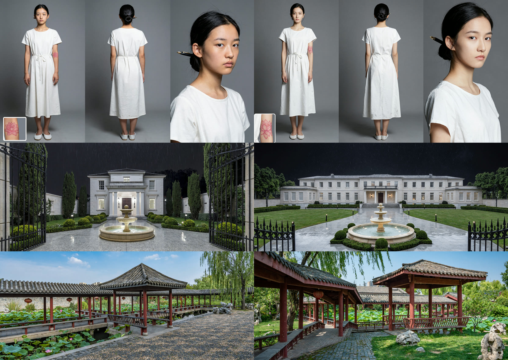
*左：打回的候选。右：按意见改了设计之后重出、选中的那张。从上到下：闻浅、别墅门口、公园回廊。*

挑图网页因此加了意见框：点「都不要，重抽」就出一个输入框，写的原因跟着选择一起复制回对话，记进 `候选/意见.jsonl`；
agent 拿到意见先判断改设计还是改提示词，没写原因就先问。网页上方可以只看待选的那几个。

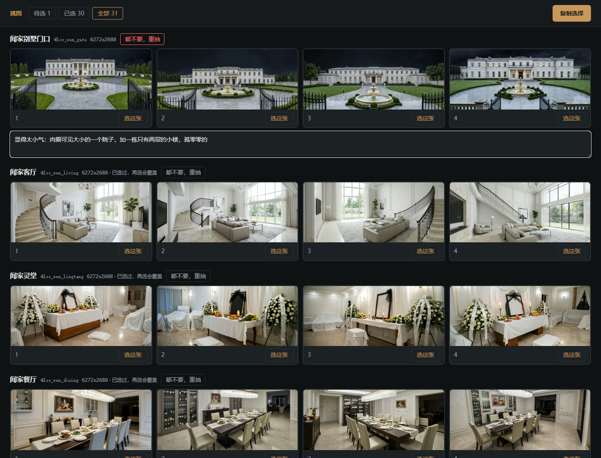
*挑图网页：上方筛选待选 / 已选 / 全部；打回的那一行下面是意见框。*

### 11. 官方 skill 可以拔掉 → 设计师直接出中文提示词

最早流水线里有三个 skill：副导演 → 设计师 → 出图 skill。出图 skill 改自 MiniMax 官方的 H3 提示词 skill，
当初加它是因为对比过：一句话的需求直接喂 H3，不如经官方 skill 扩写成完整描述再喂。

后来加了设计师，喂给出图 skill 的已经是完整的中文设计，扩写这一步其实被设计师做了，但一直没人回头重测。
写这期视频的解说稿时补了一个对照：拿三条设计原文不经出图 skill，直接当提示词喂 H3 ——
出来跟经过出图 skill 的同一个档次，差别只在机位是模型自己选的、一处冒了假字、两处细节没画，都是写法问题。

于是拔掉了出图 skill：设计师想完直接写成**中文**提示词，资产图的固定格式、参考图、只编辑一次这些规矩并进设计师，
官方指南里的五条写法也吸收进来（先说是什么图再布局再细节、风格写成看得见的、字要引号写全或声明不要字、
参考图按 `<Picture N>` 点名、编辑写最终的样子）。网页从三页变两页，仓库也因此全部是 MIT。

改完用一个全新的 agent 按新文档写了 5 张（闻浅白裙和从它编辑出的两套、手术室、瞬移特效）：

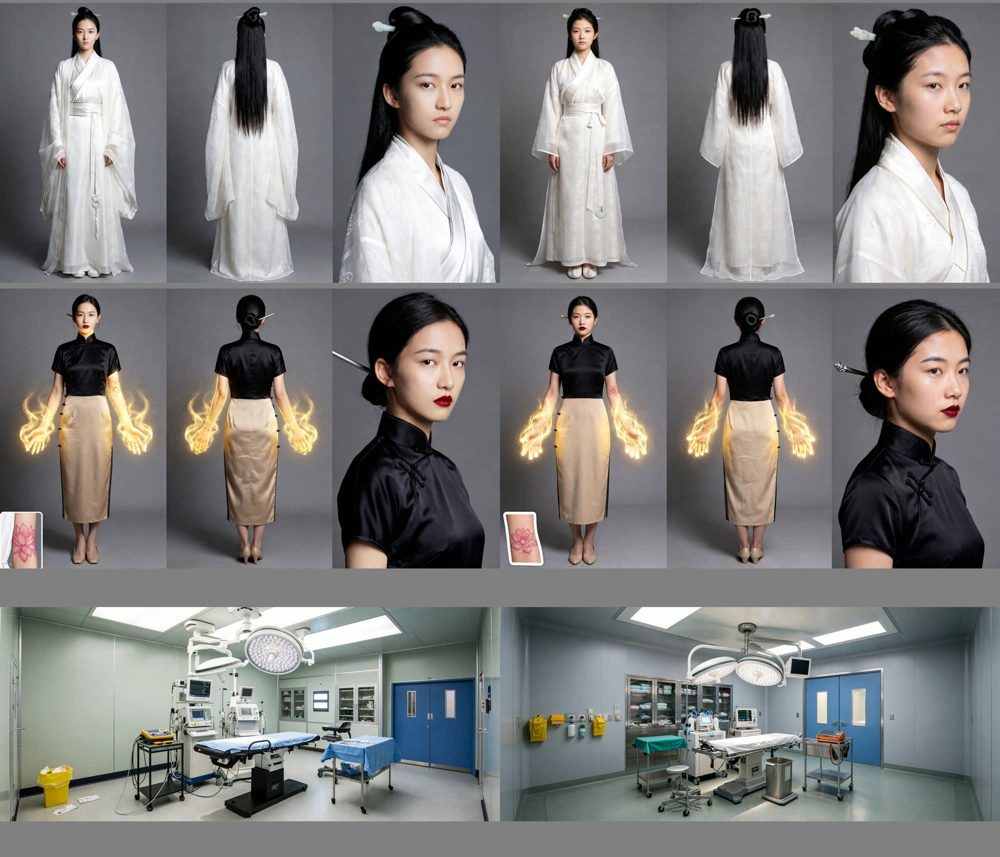
*每行左：第五遍（英文提示词，经出图 skill）。右：拔掉之后（设计师直接写的中文提示词）。从上到下：仙裙、拼色旗袍施法（都从白裙三视图编辑一次）、手术室。*

三视图版面、辨识点插图、编辑一次换装、同一个人，中文提示词都守住了；手术室的屏幕和标签没有冒出乱码字。
有两处不如第五遍，都跟中文无关、是写法：女主又被写了"颧骨不高、嘴唇偏薄"，脸往普通拉了；
瞬移特效按 16:9 出，光幕没立起来（第五遍是 3:4）。两条都补进了规则。

---

## 已知的局限

- **编辑只能一次、最多约 9MP**：H3-Image 蒸馏版没有可调的参数，连续编辑必然累积噪点；编辑输出到 16MP 会坏。需要更高分辨率的编辑图只能靠后期放大。
- **一致性是概率性的**：三视图中间那格偶尔出成正面、鞋子款式偶尔变，换个种子重出就好。
- **画面里的字**：中文招牌容易乱码。规则是除了剧本写明必须有的字，一律声明不要字。
- **盘点是猜的**：衣服剧本没写、场次地点写错、同一场日夜矛盾，agent 都会照最合理的猜，猜了什么写进汇报。漏的、错的，做分镜时会暴露，回头改盘点。

## 文件和许可

- 本仓库按 [MIT](LICENSE) 发布 —— 可以随意使用、修改、商用、再发布，保留版权声明即可，作者不承担任何担保责任。
- `art-designer/comfyui/` 里的两个官方模板来自 [Comfy-Org/workflow_templates](https://github.com/Comfy-Org/workflow_templates)（MIT）。
- 提示词的五条写法（先说是什么图再布局再细节、风格写成看得见的、字要引号写全或声明不要字、参考图按 `<Picture N>` 点名、编辑写最终的样子）
  学自 MiniMax 官方的 [H3-Image 提示词指南](https://github.com/MiniMax-AI/MiniMax-H3-Image)，本仓库没有带它的文件。
  H3-Image 模型本身按 MiniMax-H3-Image 社区许可协议使用，以官方仓库为准。
- `ad-asset-bible` 另有一个[独立发布的版本](https://github.com/EVZheng-Lab/ad-asset-bible)，下游接的是 Higgsfield 的 Lira。
  本仓库里的这份是为这条流水线改过的：不停下等审阅、没有原型清单（交给设计师）、多了几个跟出图配合的字段。
